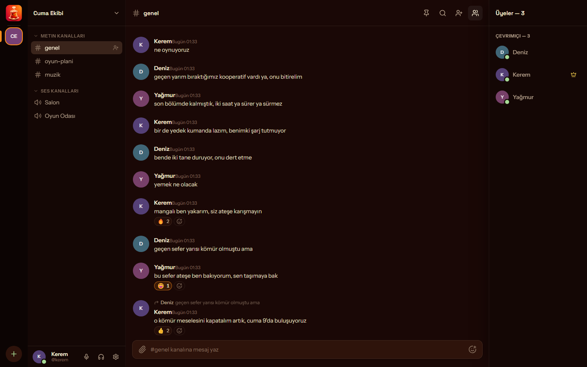
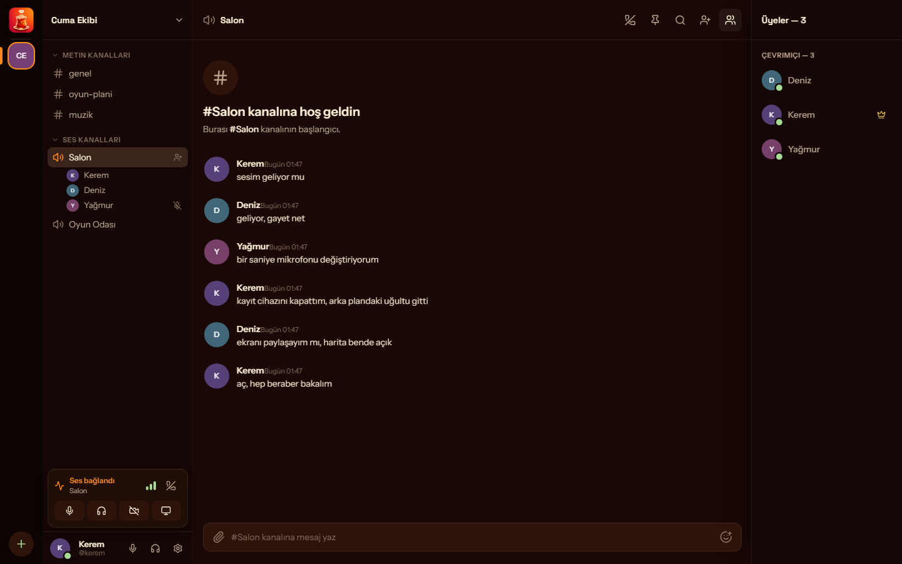
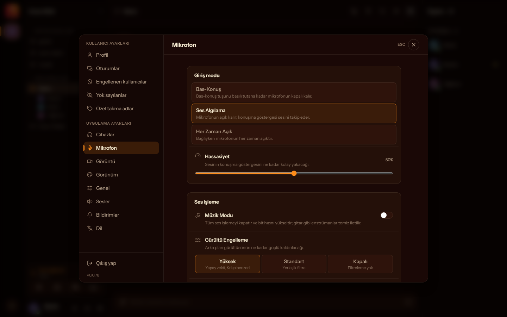
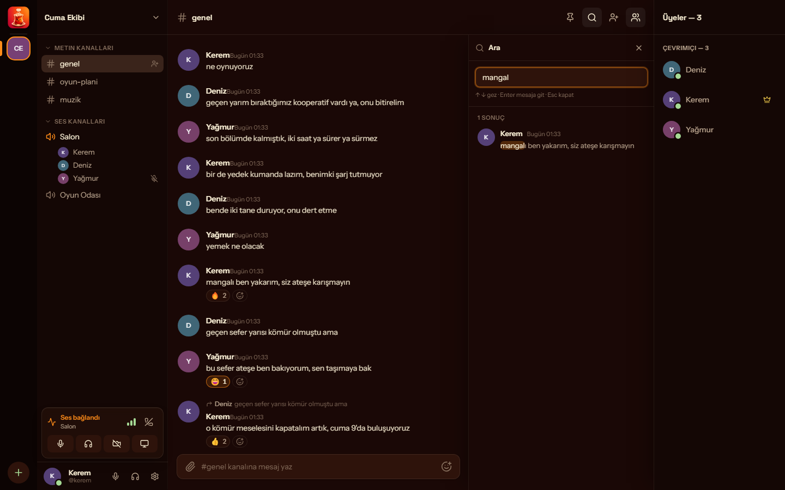

# Demli

[](https://github.com/aliblackeye/demli/actions/workflows/ci.yml)
[](LICENSE)

A private, realtime communication app for friend groups — text channels, voice rooms, screen sharing, cameras, and DM calls. Three clients: a Windows Electron desktop app (installer via `pnpm package:win`, silent auto-update), an Android Expo/React Native app (EAS OTA + in-app APK self-updater), and a web SPA sharing the desktop renderer. Backed by a self-hosted VPS (Fastify API + WS gateway + LiveKit SFU + Postgres/Redis).

Built for one group of friends rather than for scale: invite-only servers, no public directory, no ads, no recommendation feed. The bar it is held to is audio and video that stay stable through a bad connection, and desktop and mobile that do the same things — parity is tracked per feature, not claimed.

## Screenshots

Captured from the Electron app running against a local stack. The accounts, the
server and the conversation are invented fixtures — no real user data. The UI is
in Turkish here; the app ships TR and EN.



A text channel — server rail, channel list, message list with replies and reactions, member list with presence.



A voice room with three connected participants (one muted) and the voice channel's own text chat. Bottom left is the voice panel: mic, deafen, camera, screen share.



Microphone settings — input mode (push-to-talk, voice activity, always on), sensitivity, music mode, and noise-suppression levels.



Message search inside a channel, matches highlighted, while still connected to voice.

## Stack

| Layer     | Choice                                              |
| --------- | --------------------------------------------------- |
| Desktop   | Electron + React + TypeScript + Vite + Tailwind CSS |
| Mobile    | Expo + React Native (Android-first watcher app)     |
| UI        | shadcn/ui + Radix primitives                         |
| API       | Fastify + zod                                        |
| Realtime  | WebSocket (`ws`) — typed events only                 |
| Media     | LiveKit (WebRTC) — voice + screen share              |
| Data      | PostgreSQL + Redis + Drizzle                         |
| Workspace | pnpm monorepo                                        |

Hard rule: voice/video never travels over WebSocket. Media goes through WebRTC/LiveKit only.

## Layout

```txt
apps/
  desktop/      Electron app (main / preload / renderer)
  mobile/       Expo / React Native client (full parity with desktop)
  api/          Fastify HTTP API
  realtime/     WebSocket gateway
  web/          web SPA (Vite) — mounts the desktop renderer unchanged
  landing/      public marketing/download page (Vite)
packages/
  types/         shared domain types (single source of truth)
  protocol/      typed realtime event contract
  client-core/   shared HTTP + realtime clients (desktop + mobile + web)
  media/         voice + screen-share state machine + engine
  ui/            shared UI primitives (desktop/web)
  app-ui/        shared product UI shared by desktop + web
  i18n/          TR/EN catalogs (key parity enforced by tests)
  notifications/ push delivery + mute filtering
  unfurl/        link-preview fetcher
  config/        shared constants
  db/            Drizzle schema, migrations, repositories, Redis clients
docs/           product, architecture, decisions, QA
.claude/        project operating system (agents, commands, skills)
```

## Getting started

**Prerequisites:** Node >= 22, pnpm >= 9, and Docker (for Postgres, Redis and LiveKit).

Build and typecheck need **nothing but Node and pnpm** — no `.env`, no Docker. `pnpm install`,
`pnpm build`, `pnpm typecheck` and `pnpm lint` were verified green from a fresh clone
(2026-07-30):

```bash
git clone <this repo> && cd demli
pnpm install
pnpm build           # all apps + packages
pnpm typecheck
pnpm lint
pnpm test
```

`pnpm test` runs everywhere, but the API's **integration** suites need a real Postgres —
without one they report as *skipped*, not failed. Start the database first (below) to run
them for real.

**To actually run the stack**, the order matters — an empty database is the usual first
stumble:

```bash
pnpm db:up           # 1. start postgres + redis (docker compose)
pnpm db:migrate      # 2. REQUIRED on a fresh database — creates the schema
pnpm db:seed         # 3. optional: demo user/server/channels to click around in
pnpm dev             # 4. API (:4000) + WS gateway (:4001) together
pnpm dev:desktop     # 5. in a second terminal: the Electron app
```

Individual services, if you prefer separate terminals: `pnpm dev:api`,
`pnpm dev:realtime`, `pnpm --filter @demli/web dev` (browser client on :5175).

**Voice and screen share additionally need LiveKit**, which `pnpm db:up` does *not* start
(it only brings up postgres + redis):

```bash
docker compose up -d livekit    # ws://localhost:7880, devkey/devsecret
```

Packaging: `pnpm package:win` (Windows installer — NSIS + portable), `pnpm package:mac`,
`pnpm package:android`.

The mobile app lives in `apps/mobile` (Expo, its own build) — see ADR 0004; self-host
deploy is in [docs/architecture/deploy.md](docs/architecture/deploy.md).

### Env files

Every app ships an `.env.example`: root, `apps/api`, `apps/desktop`, `apps/mobile`,
`apps/realtime`, `apps/web`, `apps/landing`. Copy the ones you need to `.env`. The
defaults are local-development values (`devkey` / `devsecret` / localhost), so for a
local run you can mostly leave them alone. **Never commit real secrets** — the API
refuses to boot with `APP_ENV=production` if a secret is still a dev default or a
committed placeholder.

## Brand / logo

There is one logo file. Every app icon — desktop window/tray/installer and mobile
launcher/adaptive/splash/notification — is generated from it, so re-branding is a
one-file swap:

```bash
# 1. replace the single source (1024x1024 PNG, the mark on a transparent background)
#    assets/brand/logo.png
# 2. regenerate every icon from it
pnpm gen:icons
# 3. commit the regenerated outputs (they are versioned — no build-time step)
```

`scripts/gen-icons.mjs` paints the brand plate (indigo gradient — a token, not the
logo) behind the mark, scales it per surface, and derives the Android white-alpha
notification silhouette from the mark's alpha channel. It is idempotent. To restore
the built-in default mark, run `node scripts/gen-icons.mjs --reseed` (rewrites
`assets/brand/logo.png` from the bundled vector, then regenerates everything).

Generated outputs: `apps/mobile/assets/{icon,adaptive-icon,adaptive-icon-background,splash-icon,notification-icon}.png`,
`apps/desktop/build/{icon.ico,icon.png,tray-icon.png,tray-icon-16.png}`, and the
embedded tray + window base64 in `apps/desktop/src/main/tray-icon.ts` (embedded so
they ship inside the app bundle without a runtime `build/` asset). The desktop tray
and window icons are wired to these — no more placeholder glyph.

## Status

The original MVP (milestones 0–5: bootstrap → desktop UI → chat backend → voice →
screen share → hardening) **has shipped and runs in production**, followed by the
mobile app, roles, attachments, i18n (TR/EN), friends/DMs/profiles, message
enrichment, DM 1-1 calls with seamless group upgrade, multi-account, NSFW channels,
and the account lifecycle (freeze/purge — ADR 0014). Auto-update is live on both
platforms.

Current phase: quality depth rather than new scaffolding — keeping the voice and call
experience the best it can be on every surface, and holding the two platforms at parity.
Desktop/mobile feature parity is tracked in
[docs/product/feature-parity.md](docs/product/feature-parity.md); architecture
decisions in [docs/decisions/](docs/decisions/). Historical MVP scope:
[docs/product/mvp-scope.md](docs/product/mvp-scope.md)

## Licence

Copyright (C) 2026 Ali Karagöz.

[AGPL-3.0](LICENSE). Read it, run it for your own friends, fork it. If you modify it
and let others use it **over a network**, the AGPL asks you to offer those users your
modified source — that is the only real condition.

The **name and logo are not covered** by the licence ([TRADEMARK.md](TRADEMARK.md),
[assets/brand/LICENSE](assets/brand/LICENSE)): fork freely, ship it under your own
name. Contributing means agreeing to the CLA in [CONTRIBUTING.md](CONTRIBUTING.md),
which keeps a commercial licence possible; it is a licence to the maintainer, not an
assignment — your copyright stays yours.

Third-party code and fonts we ship (Microsoft's audio-loopback sample, Instrument
Sans, Space Grotesk, two patched npm packages) carry their own MIT/OFL notices —
all of them are listed in [THIRD-PARTY.md](THIRD-PARTY.md).

## How this repo is run

The project uses a multi-agent operating model directed by Claude Code — see [CLAUDE.md](CLAUDE.md) (the project directive) and [docs/agents/operating-model.md](docs/agents/operating-model.md). Specialist agent definitions live in `.claude/agents/`, project commands in `.claude/commands/`, and review skills in `.claude/skills/`.
